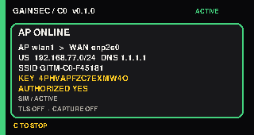

# GainSec GITM for CardputerZero


GainSec GITM is a native CardputerZero controller for creating an **authorized WPA2 access point with a physical wired-Ethernet WAN, DHCP/DNS forwarding, and NAT**. It provides a 320×170 pygame interface for APPLaunch and a narrow, package-owned privileged helper.

Version `0.1.0` is intentionally limited to the AP/DHCP/DNS/NAT workflow. **TLS interception and packet capture are not included.** Same-radio STA+AP operation is also unsupported.



## Status and scope

The source, simulator, ARM64 package build, installed-package container smoke test, and physical AP dataplane acceptance are complete. On a Debian 13 ARM64 CardputerZero, the packaged helper created the onboard-Wi-Fi AP over a physical USB-Ethernet WAN, issued DHCP configuration to a real client, forwarded DNS and HTTPS traffic through NAT, denied AP-client access to device SSH, remained healthy beyond stabilization, and restored all owned state on stop. The installed APPLaunch icon and 320×170 framebuffer route were also verified. Physical keyboard navigation and launch selection through the APPLaunch menu remain final UI acceptance gates.

Implemented:

- native 320×170 APPLaunch UI and deterministic simulator;
- AP-capability and physical-Ethernet carrier discovery;
- package-owned `gitm-ap` wireless interface and `table inet gainsec_gitm` firewall state;
- NetworkManager coexistence by making `gitm-ap` unmanaged before configuration;
- private hostapd/dnsmasq runtime state and bounded private event logging;
- fail-closed startup, exact child-process ownership, rollback, and IPv4-forwarding restoration;
- ARM64 Debian packaging with systemd socket activation.

Not implemented in `v0.1.0`:

- TLS interception, certificate installation, or certificate generation;
- packet or payload capture;
- wireless-WAN/same-radio STA+AP operation;
- user-editable AP network settings in the device UI.

## Security and authorization boundary

Use this software only on networks and client devices you own or are explicitly authorized to test.

The APPLaunch UI is unprivileged. Membership in the `gainsec-gitm` Unix group is the security authorization boundary for network changes through the group-restricted Unix socket. The on-screen authorization acknowledgment is an operator reminder; it does not grant privileges or replace group membership.

The privileged helper:

- accepts fixed structured actions rather than shell commands;
- re-discovers interfaces immediately before mutation;
- requires an AP-capable Wi-Fi interface and a linked **physical wired-Ethernet** WAN;
- rejects overlapping subnets and occupied package-owned resources;
- isolates AP clients from unrelated CardputerZero services and blocks AP-side IPv6 forwarding;
- uses a dedicated nftables table instead of flushing global firewall state;
- records and restores the previous IPv4-forwarding state;
- owns and removes only its processes, interface, firewall table, configs, and runtime state.

AP credentials are generated for each session and displayed only for the operator’s current session. Do not publish or reuse them.

## Prerequisites

### Build host

- Git
- Python 3.11 or newer
- Docker with Linux ARM64 emulation/support
- a POSIX shell

### CardputerZero

- a current Debian-based CardputerZero image with APPLaunch;
- onboard Wi-Fi capable of AP mode;
- a connected physical USB/wired Ethernet adapter for WAN;
- administrator access for package installation and group assignment.

The Debian package declares its runtime dependencies: Python 3, pygame, hostapd, dnsmasq-base, NetworkManager, nftables, iw, iproute2, systemd, and adduser.

## Clone and set up a development environment

The canonical public repository is <https://github.com/GainSec/GITM-CardputorZero>.

```sh
git clone https://github.com/GainSec/GITM-CardputorZero.git
cd GITM-CardputorZero
python3 -m venv .venv
.venv/bin/pip install -e '.[test]'
```

## Simulator and source commands

Render a deterministic 320×170 frame without network changes:

```sh
PYGAME_HIDE_SUPPORT_PROMPT=1 \
SDL_VIDEODRIVER=dummy \
SDL_AUDIODRIVER=dummy \
.venv/bin/python -m gitm gui \
  --backend sim \
  --demo-state ACTIVE \
  --screenshot /tmp/gitm-active.png
```

Read-only simulator commands:

```sh
.venv/bin/gitm status --backend sim
.venv/bin/gitm preflight --backend sim
.venv/bin/gitm render-plan --backend sim
```

Use `--backend system` only on the target after installing and authorizing the package. The system backend fails closed if its helper, tools, AP-capable radio, physical wired WAN, or safe non-overlapping subnet is unavailable.

## Build and verify

Run the warnings-as-errors suite and static checks:

```sh
PYTHONPATH=src PYGAME_HIDE_SUPPORT_PROMPT=1 \
SDL_VIDEODRIVER=dummy SDL_AUDIODRIVER=dummy \
.venv/bin/python -W error -m pytest -q

python3 -m compileall -q src tools tests
find packaging tools tests -type f -name '*.sh' -exec sh -n {} \;
git diff --check
```

Build the ARM64 Debian package from the current sanitized checkout, then run the installed-package ARM64 smoke test:

```sh
tools/build_deb.sh
tools/smoke_arm64.sh
```

The local artifact is written to:

```text
dist/gainsec-gitm_0.1.0-1_arm64.deb
```

No package or GitHub Release is assumed to exist yet; install the locally built `.deb` as described below.

## Install on CardputerZero

Copy the locally built package to the CardputerZero, then install it with dependencies:

```sh
sudo apt install ./gainsec-gitm_0.1.0-1_arm64.deb
sudo usermod -aG gainsec-gitm "$USER"
sudo systemctl enable --now gainsec-gitm-helper.socket
```

Log out and back in after changing group membership. Confirm the package and helper socket:

```sh
dpkg-query -W gainsec-gitm
systemctl is-enabled gainsec-gitm-helper.socket
systemctl is-active gainsec-gitm-helper.socket
gitm status --backend system
```

Without the socket and group membership, system preflight fails closed.

## APPLaunch workflow

APPLaunch starts `/usr/share/GITM/bin/gitm`, which runs the native GUI with `--backend auto`. The general `/usr/bin/gitm` command remains a normal CLI wrapper.

1. Connect the CardputerZero to a working physical wired-Ethernet WAN.
2. Open **GainSec GITM** in APPLaunch.
3. Press `C`, Space, or Enter to run preflight.
4. Review the detected AP radio, wired WAN, subnet, resolver, generated session SSID/key, disabled modules, and authorization state.
5. Press `C` once to acknowledge that every participating device is authorized.
6. Press `C` again to start the AP, DHCP/DNS forwarding, firewall isolation, and NAT.
7. After the **ACTIVE** screen appears, connect only authorized clients using the credentials shown on-device.
8. Press `C` while active to stop and restore owned state before disconnecting Ethernet or closing the app.

A short `Z` or Escape press goes back. APPLaunch owns the long Escape hold and may terminate the application process group. On signal or normal exit, the application attempts to stop an owned active session.

## Safe AP/DHCP/DNS/NAT behavior

The helper creates a separate `gitm-ap` VIF, marks it unmanaged in NetworkManager, assigns the private gateway, starts foreground hostapd and dnsmasq children, installs only `table inet gainsec_gitm`, and enables forwarding only after recording the prior value. Startup is reported active only after a stabilization interval and liveness checks.

On stop or failed startup, it terminates only children whose full persisted identities still match, removes its VIF and nftables table, deletes private configs, and restores the previous forwarding state. Corrupt or unverifiable ownership state blocks further mutation rather than guessing.

If stop reports an error, do not manually delete `/run/gainsec-gitm/private/state.json`: retain it for recovery and inspect the service logs first.

## Screenshots

All six tracked store screenshots are 320×170 deterministic simulator frames; displayed credentials are synthetic test-only fixtures, not live AP credentials.

- [Preflight](screenshots/preflight.png)
- [Review](screenshots/review.png)
- [Starting](screenshots/starting.png)
- [Active](screenshots/active.png)
- [Stopping](screenshots/stopping.png)
- [Error](screenshots/error.png)

## Limitations

- The AP/DHCP/DNS/NAT and cleanup path is physically verified; physical keyboard navigation and launch selection through APPLaunch still require final acceptance.
- The first AP-capable idle Wi-Fi interface and first linked physical Ethernet interface are selected automatically.
- Country, subnet, and resolver currently use validated release defaults.
- The wired WAN must remain available for the session.
- IPv6 forwarding from the AP is blocked rather than routed.
- The app does not provide TLS interception, packet capture, traffic decryption, or a certificate authority.

## Cleanup and uninstall

Stop the owned session from the UI before uninstalling. Then run:

```sh
gitm status --backend system
sudo apt remove gainsec-gitm
```

Package removal asks the helper to clean up owned resources before removing the service. If cleanup cannot be proven, removal fails deliberately so recovery evidence and the only helper capable of cleanup are retained. Use `sudo apt purge gainsec-gitm` after a successful stop if package configuration should also be removed. Group membership is not automatically removed; an administrator may remove it after confirming no other installation uses the group.

## Development and contributions

Run the complete warnings-as-errors tests, compileall, package build, and ARM64 installed-package smoke test before submitting a pull request. Keep network mutations fail-closed, package-owned, reversible, and covered by tests. Do not add broad firewall flushes, global process kills, sudoers bypasses, embedded credentials, private keys, captures, or TLS interception under the `v0.1.0` feature claim.

See [CONTRIBUTING.md](CONTRIBUTING.md) for the contribution checklist. Report suspected vulnerabilities privately through the repository’s GitHub **Security** tab; do not open a public issue for an undisclosed vulnerability. See [SECURITY.md](SECURITY.md).

## Lineage and license

This CardputerZero port is maintained at <https://github.com/GainSec/GITM-CardputorZero>. It was derived from GainSec’s earlier Bash prototype at <https://github.com/GainSec/gainsec-in-the-middle>, pinned during the port at commit `ddb48cec4a0df7286ef69fdefd287f32e52aff27`. The unsafe historical prototype and its absent certificate-profile corpus are not included in this public candidate and are never invoked or packaged.

MIT — see [LICENSE](LICENSE).
